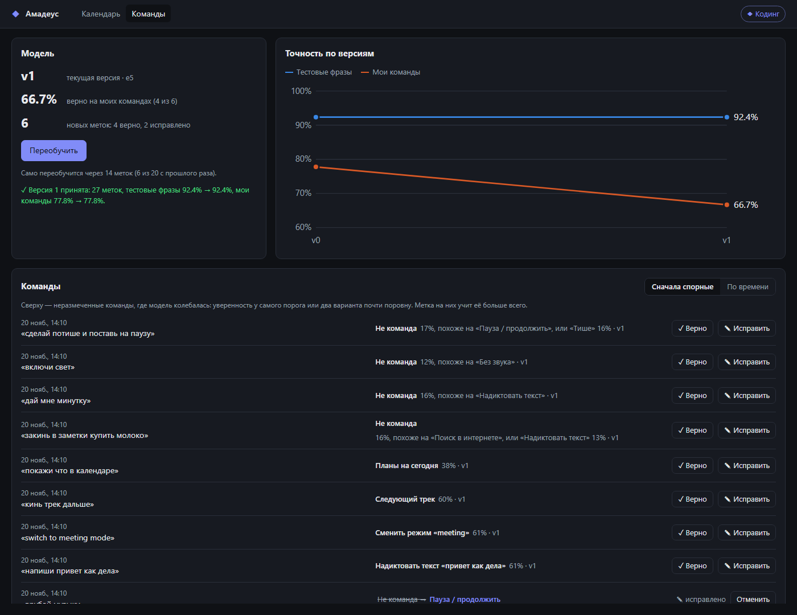
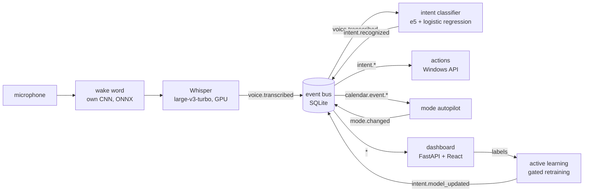
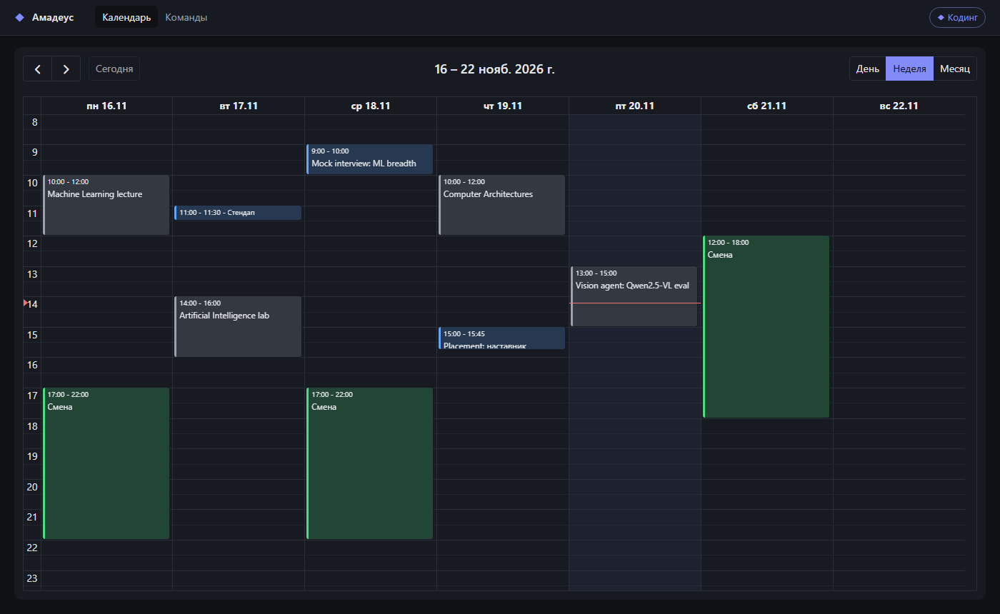

# AI For Me

[](https://github.com/KernerlRace/Ai-For-Me/actions/workflows/tests.yml)

[](LICENSE)

A personal AI layer for my own Windows machine, built as a set of small ML systems rather than a wrapper around one
LLM call. Say «Амадеус» and a command in Russian or English, and it acts: a wake-word CNN trained from scratch,
Whisper on the GPU, an intent classifier that retrains itself on the commands I label, a mode autopilot that sets the
machine up for coding, gaming or a meeting, and a vision agent that learns to click what it is told to on any screen.

Each part has a baseline, a held-out evaluation and a write-up of what went wrong — the goal is the whole ML
lifecycle: data, training, evaluation, deployment and a feedback loop.


<sub>The dashboard's Commands page on [demo data](#try-it): made-up commands, but classified, labelled and
retrained by the real pipeline. The UI is in English by default, with an EN/RU switch; the demo commands come in
either language (`--lang ru`), since the classifier is trained on both.</sub>

## Results

| Component | Approach | Baseline | Result | Measured on |
|---|---|---|---|---|
| [Wake word](aiforme/voice_orchestrator/README.md#results-wake-word) | 60k-parameter CNN on log-mel features, trained from scratch on my recordings; augmentation, hard-negative mining, synthetic whispers | v1, 10 min of room audio: 84% found, ≈12 false accepts an hour | **92%** found, **0** false accepts in 22 min of held-out audio | a test session recorded on another day, streamed through the exported ONNX model |
| [Intent recognition](aiforme/voice_orchestrator/README.md#results-intent-recognition) | multilingual-e5 embeddings + logistic regression, 16 intents + out-of-scope, threshold chosen by cross-validation | TF-IDF character n-grams: 85.9% | **92.4%** on text, **90.0%** through speech (Whisper) | 170 held-out phrases written separately, scored once per model |
| [Active learning](aiforme/active_learning/README.md) | uncertainty sampling for labelling; gated retraining — a candidate replaces the model only if it loses ≤ 1 test phrase and is at least as accurate on the new labels, scored out of fold | — | the gate caught a regression no unit test would: a re-tuned threshold cost 6 test phrases | the held-out phrases + my labelled commands |
| [Vision grounding](aiforme/vision_agent/README.md#results) | local Qwen2.5-VL 7B reads the screenshot; its click is snapped to the nearest element; UI Automation answers first where a command is an element's name | UI Automation name matching: 100% when the command is the element's name, **0%** in my own words | **62.7%** in my own words (59 tasks), 0.8 s a click; the hybrid keeps 100% on names | 7 system windows, boxes labelled for free by UI Automation; 95% intervals and McNemar tests in the module README |
| [Mode autopilot](aiforme/mode_autopilot/README.md) | rules with hysteresis now; every 5 s of activity logged as training data for a learned model | — | running daily; data collecting | — |

### What the experiments taught me

- **Pretraining is what 314 examples cannot replace.** A character CNN trained from scratch reached 72.4%, below
  TF-IDF with no training at all (85.9%); a pretrained multilingual encoder reached 92.4%. MiniLM, also multilingual,
  managed only 68.5% on Russian commands — an encoder has to be checked on each language it will hear.
- **The random seed moved recall more than my best idea did.** Synthetic whispers added about two whispered wake
  words in ten, but retraining the same recipe with seeds 0, 1 and 2 gave 92%, 98% and 82% on the test session. I had
  fixed seed 0 before the runs, so choosing seed 1 afterwards would have been tuning on the test set; averaging
  models across seeds is the next step.
- **A threshold re-tuned on every retraining moves by noise, and the gate noticed.** Six slang labels shifted the
  cross-validated out-of-scope threshold from 0.20 to 0.22, and six unrelated test phrases fell out of scope. The
  threshold is now chosen once and carried between versions, so the gate measures what the labels taught.
- **A second speaker exposed speaker overfitting.** Trained on my voice, v3 fired on 21 of 60 of a friend's ordinary
  commands: it had learned my voice more than the word. Adding her recordings made it worse until hard negatives
  were mined from each source separately, with its own cap.
- **Synthetic data alone did not transfer.** Trained only on Windows' synthetic voices, the wake word fired 13 times
  in 2 minutes of my room.
- **A local VLM declined to answer far more than it failed to see.** Allowed to answer "not visible", Qwen2.5-VL
  did so on 43% of tasks, even on a red square on a blank image. Without that escape it found 22 points more of my
  own commands. That same red square later showed that Ollama resizes some images itself, which had shifted every
  File Explorer click by 9%. The grounder now measures the server's frame instead of trusting it.
- **My own labels had a bug.** The list of similar-sounding negatives contained «Амадеуса нет» — the wake word
  itself. Transcribing the negative recordings with Whisper found it; the recorder now logs the prompt behind every
  file.

Every evaluation is saved as JSON with each error in [`eval/results/`](eval/results). The limits are written next to
the numbers in each module's README — for example, zero false accepts in 22 minutes bounds the rate at about 8 an hour
(the rule of three), not below one.

## How it works

Modules never call each other. Each one reads events from a shared bus and publishes new ones — event in, event out —
so every module can be built, tested and restarted on its own:



The bus (`aiforme/core/bus.py`) is a SQLite log with one cursor per module, shared by several processes through one
file. Delivery is at least once and in order: handling an event publishes the module's outputs and moves its cursor
in one transaction, so a crash never loses an event or publishes its outputs twice. An exception in a module becomes a
`system.error` event instead of blocking the queue.

A module is a small class:

```python
class Echo(Module):
    name = "echo"
    subscribes = ("ping.*",)

    def handle(self, event):
        yield Event("pong.sent", {"reply_to": event.id})
```

Models run locally: privacy, no per-call cost, and the ML stays mine. The vision model is reached over HTTP, so moving
it from this PC's RTX 3060 Ti (8 GB, shared with Whisper) to a dedicated inference server is a change of address.

## Modules

| Module | What it does | Status |
|---|---|---|
| [`voice_orchestrator`](aiforme/voice_orchestrator) | Wake word + Whisper + intent and slots → actions on Windows, 16 intents | done |
| [`wakeword`](aiforme/wakeword) | Recording tool, augmentation, synthetic whispers, CNN training with hard-negative mining, ONNX detector | done, v5 |
| [`mode_autopilot`](aiforme/mode_autopilot) | Detects coding / gaming / meeting from processes and the calendar and switches the machine | rules running; learned model waits for data |
| [`active_learning`](aiforme/active_learning) | Labels on heard commands, uncertainty ranking, gated retraining, model versions | done; real numbers fill with use |
| [`dashboard`](aiforme/dashboard) | Calendar, commands and labels, accuracy by version | running |
| [`vision_agent`](aiforme/vision_agent) | Screenshot + accessibility tree → grounding dataset; VLM grounding | dataset and baseline done; VLM next |
| `finance-tracker` | Calendar shifts → pay and tax; receipt screenshots → OCR → categorised expenses | planned |
| `security-watchdog` | Anomaly detection over processes and network connections | planned |
| `memory-graph`, `universal-search` | Long-term memory as a knowledge graph; one semantic search over code, notes and history | planned |

The plan for the rest, with the ML approach for each module, is in [ROADMAP.md](ROADMAP.md); the modules not started
yet have READMEs in [`modules/`](modules).

<details>
<summary>The calendar page</summary>



</details>

## Try it

Using [uv](https://docs.astral.sh/uv/):

```bash
uv sync --all-extras          # or plain `uv sync` for the core and the tests
uv run pytest -q
```

See the dashboard without a microphone or weeks of use — made-up commands, put through the real classifier, labelled
and retrained on:

```bash
uv run python -m aiforme demo --dir ~/aiforme-demo --embedder tfidf   # seconds; e5 is what the assistant runs
                                                                        # --lang ru: the commands in Russian
cd aiforme/dashboard/web && npm install && npm run build && cd ../../..
AIFORME_DATA_DIR=~/aiforme-demo uv run python -m aiforme dashboard   # http://127.0.0.1:8765
```

The assistant itself (Windows, an NVIDIA GPU for real-time Whisper):

```bash
uv run python -m aiforme run                  # «Амадеус», then a command
uv run python -m aiforme run --push-to-talk   # Enter instead of the wake word
uv run python -m aiforme say "открой телеграм" # a typed command to a running assistant
uv run python -m aiforme tail -n 20 'intent.*'
```

## Tech stack

Python · PyTorch · ONNX Runtime · faster-whisper · sentence-transformers · scikit-learn · NumPy · SQLite ·
FastAPI · React · TypeScript · Vite · Windows API (ctypes, UI Automation) · GitHub Actions (Windows and Linux)

## Project structure

| Path | Purpose |
|---|---|
| `aiforme/core/` | The event type, the SQLite event bus, the module interface and basic memory |
| `aiforme/voice_orchestrator/` | Listener, Whisper, intent classifier, Windows actions, evaluations |
| `aiforme/wakeword/` | Own wake-word model: recording, synthetic data, augmentation, training, ONNX detector |
| `aiforme/mode_autopilot/` | Activity sampling, mode rules, what each mode does, the activity log |
| `aiforme/active_learning/` | Labels, gated retraining, model versions |
| `aiforme/calendar/` | The assistant's own calendar and the watcher that announces events on the bus |
| `aiforme/dashboard/` | FastAPI backend; React + Vite frontend in `web/` |
| `aiforme/vision_agent/` | Window snapshots via UI Automation, the grounding dataset, grounders and their evaluation |
| `aiforme/demo.py` | Made-up data for the dashboard, run through the real pipeline |
| `eval/results/` | Every evaluation as JSON, including each test error |
| `tests/` | pytest suite, run in CI on Windows and Linux |
| `tools/mac_recorder/` | A standalone recorder for collecting a second speaker's wake-word data |

State lives in `data/` (or `AIFORME_DATA_DIR`), which git ignores: recordings, commands and window snapshots are
personal.

## Roadmap

- [x] Phase 0 — event bus, module interface, basic memory, CI and tests
- [x] Phase 1 — voice orchestrator: own wake-word model, Whisper STT, intents in two languages, four embeddings compared
- [ ] Phase 2 — mode autopilot: process detection, own calendar, mode rules and voice ✔; learned mode model
- [x] Phase 3 — active learning: labelling UI, uncertainty sampling, gated retraining, accuracy by version
- [ ] Phase 4 — vision agent: grounding dataset and baseline ✔; local VLM; the agent on the bus; multi-step tasks
- [ ] Phase 5 — finance tracker: shifts → pay and tax, receipt OCR and categorisation, savings goals
- [ ] Phase 6 — security watchdog and password vault
- [ ] Phase 7 — learning tracker: topic graph, flashcards, summaries
- [ ] Phase 8 — memory graph and universal search
- [ ] Phase 9 — dashboard and mobile companion
- [ ] Phase 10 — resume builder and smaller features
