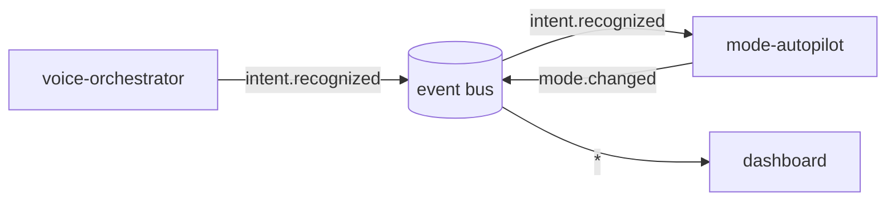

# AI For Me

[](https://github.com/KernerlRace/Ai-For-Me/actions/workflows/tests.yml)

[](LICENSE)

A personal AI layer for my own machine: a voice-controlled orchestrator that also acts on its own — switching the environment between coding and gaming, watching the system for anomalies, turning calendar shifts and receipt screenshots into a finance tracker, and giving a screen-reading agent the ability to act in any application instead of a fixed command set.

> **Status:** Phase 3 under way — [active learning](aiforme/active_learning): commands the assistant heard are
> labelled on the dashboard, retrain the intent classifier, and a new version replaces the running one only if it
> loses at most one held-out test phrase and does at least as well on the labelled commands, scored out of fold.
> Phase 2 is running — the [mode autopilot](aiforme/mode_autopilot) switches the machine between normal,
> coding, gaming and meeting modes on its own, with its own calendar and the first page of the
> [dashboard](aiforme/dashboard) (FastAPI + React); the learned mode model waits for weeks of activity data.
> Phase 1 is done — the [voice orchestrator](aiforme/voice_orchestrator) works end to end: wake word,
> Whisper on the GPU, intent recognition in Russian and English (92.4% on held-out phrases, 90.0% through speech) and
> 14 actions on Windows, woken by «Амадеус» — a wake-word CNN trained from scratch on my own recordings and a second speaker's, with hard-negative mining (92% of wake words in a separate test session — all misses whispered — and no false accepts in 22 minutes of held-out audio). Phase 0 — the event
> bus, the module interface and basic memory — is done. The architecture, the ML approach for each module and the
> phased build order are written up in [ROADMAP.md](ROADMAP.md).

## Why

The goal is a full ML lifecycle — data, training, evaluation, deployment and a feedback loop — rather than a wrapper around a single LLM call. The assistant is planned as a set of independent ML subsystems wired together by a shared event bus and a common memory — intent classification with an active-learning feedback loop, a vision-language agent that acts from screenshots, OCR and categorization for expense tracking, anomaly detection for system security, a knowledge graph for long-term memory — each with its own baseline, its own evaluation, and a reason to exist on its own.

## How it works

Modules never call each other. Each one reads events from a shared bus and publishes new ones — event in, event out —
so every module can be built, tested and restarted on its own:



The bus (`aiforme/core/bus.py`) is a SQLite log with one cursor per module, shared by several processes through one
file. Delivery is at least once and in order: handling an event publishes the module's outputs and moves its cursor
in one transaction, so a crash never loses an event or publishes its outputs twice. An exception in a module becomes a
`system.error` event instead of blocking the queue. Basic memory (`aiforme/core/memory.py`) keeps JSON values per
module namespace until the knowledge graph of Phase 8 replaces it.

A module is a small class:

```python
class Echo(Module):
    name = "echo"
    subscribes = ("ping.*",)

    def handle(self, event):
        yield Event("pong.sent", {"reply_to": event.id})
```

## Planned modules

| Module | What it will do |
|---|---|
| `voice-orchestrator` | Wake word + STT + intent classification → executes commands on the machine |
| `mode-autopilot` | Detects context (coding / gaming / meeting via calendar) and switches the environment |
| `vision-agent` | Screenshot + a vision-language model → acts in any application, not just pre-defined intents |
| `active-learning` | Logs misclassified commands, retrains the intent classifier, tracks accuracy over time |
| `security-watchdog` | Anomaly detection over running processes and network connections |
| `password-vault` | Local encrypted password store with breach checks |
| `finance-tracker` | Work shifts in the calendar → pay/tax calculation and savings goals; receipt screenshots → OCR'd, categorized expenses |
| `learning-tracker` | Builds a topic graph from what I study (course material, tutorials), generates spaced-repetition flashcards |
| `memory-graph` | Long-term memory as a knowledge graph (projects, people, habits), shared across modules |
| `universal-search` | Semantic search across code, notes, clipboard history and learning material at once |
| `dashboard` | Shows what the assistant did and why, plus finance/learning/security widgets |
| `mobile-companion` | Push notifications and remote approval when away from the machine |
| `resume-builder` | Drafts resume bullet points from commit history and finished modules |

## Tech stack

In use: Python · PyTorch · ONNX Runtime · faster-whisper · sentence-transformers · scikit-learn · NumPy · SQLite · sounddevice · psutil · Windows API (ctypes) · FastAPI · React · TypeScript · Vite · FullCalendar

Planned: a vision-language model for the screen agent · Tesseract/PaddleOCR · Chroma

## Project structure

| Path | Purpose |
|---|---|
| `aiforme/core/events.py` | The `Event` type and topic rules (`voice.transcribed`, patterns like `voice.*`) |
| `aiforme/core/bus.py` | Event bus on SQLite: publish, per-module cursors, atomic completion |
| `aiforme/core/module.py` | The `Module` interface and the loop that runs modules against the bus |
| `aiforme/core/memory.py` | Basic long-term memory: JSON values under (namespace, key) |
| `aiforme/voice_orchestrator/` | Phase 1: listener, Whisper, intent classifier, Windows actions — [its README](aiforme/voice_orchestrator/README.md) has the results |
| `aiforme/mode_autopilot/` | Phase 2: activity sampling, mode rules, what each mode does, the activity log |
| `aiforme/active_learning/` | Phase 3: labels on heard commands, gated retraining, model versions — [its README](aiforme/active_learning/README.md) |
| `aiforme/calendar/` | The assistant's own calendar and the watcher that announces events on the bus |
| `aiforme/dashboard/` | Local web UI: the calendar and the commands page; FastAPI backend, React + Vite frontend in `web/` |
| `aiforme/wakeword/` | Own wake-word model: recording tool, synthetic data, augmentation, CNN training, ONNX detector |
| `eval/results/` | Every evaluation as JSON, including each test error |
| `aiforme/__main__.py` | Command line: `run` the assistant, `say` a typed command, `retrain`, publish and tail events |
| `tests/` | pytest suite, run in CI on Windows and Linux |
| `ROADMAP.md` | Full plan: ML approach per module, architecture, tech stack, phased build order |
| `modules/` | READMEs of the modules not started yet; a started module moves into `aiforme/` |
| `.env.example` | Required environment variables — copy to `.env` |

## Quick start

Using [uv](https://docs.astral.sh/uv/):

```bash
uv sync --all-extras          # or plain `uv sync` for the core and the tests
uv run pytest -q
uv run python -m aiforme run  # the voice assistant, see aiforme/voice_orchestrator/README.md
```

Watch the bus by hand (state lives in `data/`, or in `AIFORME_DATA_DIR` if set):

```bash
uv run python -m aiforme publish voice.transcribed '{"text": "open the terminal"}'
uv run python -m aiforme tail -n 20 'voice.*'
```

## Roadmap

- [x] Vision, module list, architecture and build order
- [x] Phase 0 — repository layout, shared event bus, basic memory, CI and tests
- [x] Phase 1 — voice orchestrator: own wake-word model, Whisper STT, 14 intents, four embeddings compared
- [ ] Phase 2 — mode autopilot: process detection, own calendar, mode rules and voice ✔; learned mode model
- [ ] Phase 3 — active learning loop: corrections UI, retraining, accuracy over time
- [ ] Phase 4 — vision agent: screenshot + VLM on simple tasks, then arbitrary actions
- [ ] Phase 5 — finance tracker: shifts → pay and tax, receipt OCR and categorization, savings goals
- [ ] Phase 6 — security watchdog and password vault
- [ ] Phase 7 — learning tracker: topic graph, flashcards, summaries
- [ ] Phase 8 — memory graph and universal search
- [ ] Phase 9 — dashboard and mobile companion
- [ ] Phase 10 — resume builder and smaller features

Full detail, including the ML approach for every module, is in [ROADMAP.md](ROADMAP.md).
