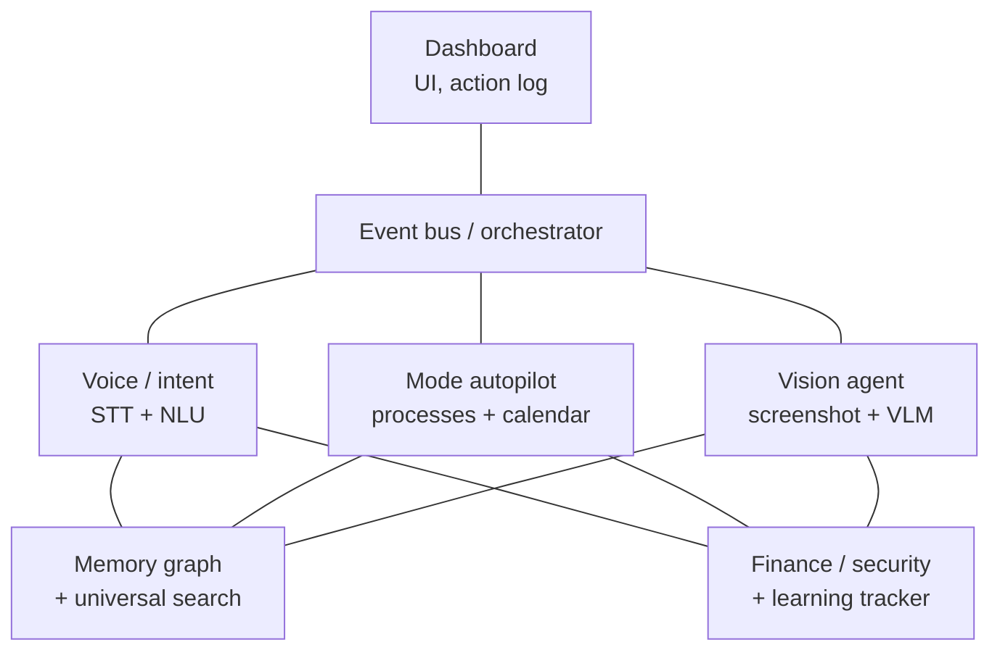

# Roadmap

## Vision

A personal AI that lives on the machine and:
- listens to voice commands and controls the system,
- switches the environment on its own depending on context (coding / gaming / a meeting),
- sees the screen and can act inside any application, not only through pre-defined commands,
- learns from its own mistakes (active learning for the intent classifier),
- tracks finances (shifts, pay, taxes, savings goals, receipt screenshots),
- watches the system for security anomalies,
- helps with studying, and ties all of this into one memory with semantic search over it.

As a portfolio project, the goal is to show a full ML lifecycle — data, training, evaluation, deployment, feedback loop — rather than a wrapper around a single API.

---

## Modules and the ML inside them

### 1. Voice Orchestrator (core)
- Wake word (a small fine-tuned CNN, or `openWakeWord`)
- STT: `faster-whisper`, run locally
- NLU: a fine-tuned intent classifier (DistilBERT/embeddings) with slot filling
- Action layer: executes the recognized intent (open an app, find a file, dictate text)

### 2. Mode Autopilot
- Detects the active context: running processes (IDE/game), calendar events (Google Calendar API)
- Rules for switching the environment: opens the right windows/terminals/containers for a project, enables a game mode (closes background processes), sets do-not-disturb before a meeting
- Restores the window layout per project

### 3. Vision Agent (the centerpiece)
- Screenshot → vision-language model → an action plan → executed through clicks/keystrokes
- Used whenever there is no matching pre-defined intent — the agent "sees" and acts like a person would
- The same OCR core is reused by the finance tracker to read expense screenshots

### 4. Active Learning Loop
- Logs every case where the user corrected a misrecognized command
- Periodically retrains the intent classifier on these corrections
- Tracks accuracy over time — a real ML lifecycle, not a one-off training run

### 5. Security Watchdog
- Monitors running processes and network connections
- An anomaly detection model (isolation forest / autoencoder) trained on a baseline of "normal" system behavior
- Alerts by voice or push notification

### 6. Password Vault
- Local encrypted store (AES, master password)
- Breach checks (k-anonymity query against a HIBP-style service, without ever sending the password itself)
- Autofill through a local helper

### 7. Finance Tracker
- Calendar event type "work shift" (hours, rate) → automatic pay calculation with tax deducted
- Savings goals: progress and a forecast based on the current pace
- Expenses: a screenshot of a transaction → OCR → a category classifier (food/transport/subscriptions) → stored
- Dashboard: income vs. expenses, a subscription audit (recurring payments not used in a while)

### 8. Learning Tracker
- A topic graph built automatically from what I study (coding tutorials) plus course material
- Auto-generated flashcards / spaced repetition from notes and articles
- A voice self-quiz before an exam
- Summarization of study material

### 9. Memory / Knowledge Graph
- Structured long-term memory, not just a vector store — entities (projects, people, habits, topics) and the relations between them
- Used by every other module as shared context

### 10. Universal Search
- One semantic search over code, notes, clipboard history, study material and command history
- Embeddings + a local vector DB (Chroma/FAISS)

### 11. Dashboard
- A UI with a log of what the assistant did and why
- Finance widgets, learning progress, current mode, security alerts

### 12. Mobile Companion
- Push notifications and action-approval requests while away from the machine
- A remote view of the dashboard

### 13. Resume Builder
- Analyzes commits/projects and drafts resume bullet points

### Smaller features
- Semantic search over clipboard history (part of Universal Search)
- Voice notes on the fly → Memory Graph
- Auto-backup before a risky git operation (rebase/reset/force-push)
- Health nudges after long sessions without a break
- Post-match summaries (Dota 2 via OpenDota/Steam API, World of Tanks via the Wargaming API)
- A code-review assistant that comments on commits before they are pushed

---

## Architecture (high level)

Each module is its own process/package, talking over a local event bus (Redis pub/sub, or just SQLite with polling to start, migrating to a proper queue later).

## Stack (draft)

- **Core language**: Python (ML components, orchestration)
- **STT**: faster-whisper
- **NLU**: HuggingFace transformers (a fine-tuned DistilBERT/MiniLM), or sentence embeddings with a classical classifier
- **Vision agent**: a local or hosted VLM + an action executor (pyautogui / Win32 API)
- **OCR**: Tesseract or PaddleOCR
- **Vector DB**: Chroma or FAISS
- **Anomaly detection**: scikit-learn (IsolationForest) first, an autoencoder later
- **Dashboard**: FastAPI backend + a React/Next.js frontend (or a local Tauri/Electron app to start)
- **Mobile companion**: React Native, or push through a Telegram bot for a much faster MVP
- **Storage**: SQLite locally (moving to Postgres if needed)
- **Vault encryption**: libsodium / AES-GCM

---

## MVP phases

### Phase 0 — Foundation
- Repository layout, a shared event bus, basic memory (SQLite)
- CI, tests, lint config

### Phase 1 — Voice Orchestrator MVP
- Wake word + STT + 10-15 intents (open an app, find a file, dictate text)
- A baseline intent classifier (no fine-tuning yet, embeddings-based)

### Phase 2 — Mode Autopilot
- Process detection (IDE/game), basic environment-switching rules
- Google Calendar integration (meetings → do-not-disturb)

### Phase 3 — Active Learning Loop
- A UI to correct misrecognized commands
- The retraining pipeline + accuracy tracking over time

### Phase 4 — Vision Agent (MVP)
- Screenshot + VLM on simple tasks (open a menu, click a described button)
- Extending to arbitrary actions

### Phase 5 — Finance Tracker
- Calendar shifts → pay/tax calculation
- OCR for expenses + categorization
- Savings goals + forecasting

### Phase 6 — Security Watchdog + Password Vault
- A baseline of "normal" system behavior, anomaly detection
- An encrypted vault with breach checks

### Phase 7 — Learning Tracker
- Topic graph, flashcards, summarization of course material

### Phase 8 — Memory Graph + Universal Search
- Moving from a flat vector store to a knowledge graph
- One search over every source

### Phase 9 — Dashboard + Mobile Companion
- A full UI, push notifications, remote action approval

### Phase 10 — Polish
- Resume builder, post-match summaries, the code-review assistant, health nudges, subscription audit

---

## Development principles

- Each module is its own package with its own tests and a minimal public interface (event in → event out)
- ML components ship a baseline (no training) and an improved version (fine-tuned) — visible in the commit history and in each module's README
- Secrets (tokens, passwords, keys) are never committed — `.env` is gitignored, `.env.example` documents what is needed
