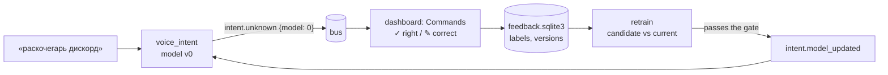

# Active Learning

Phase 3 of [AI For Me](../../README.md): the commands the assistant actually hears, labelled by me in the
[dashboard](../dashboard), retrain the [intent classifier](../voice_orchestrator), and a new version replaces the
running one only if it passes a gate.

## The loop

1. Every `intent.recognized` / `intent.unknown` event names the model version that produced it.
2. On the dashboard's **Commands** page each heard command gets **✓ Верно** or **✎ Исправить** — the right intent
   and, for intents that take one, the slot as words of the command (*«раскочегарь дискорд»* → open app
   *«дискорд»*). Both kinds are labels: a confirmed command is as much a real, transcribed training example as a
   corrected one. A label stays pending, and can be changed or undone, until a version trains on it.
3. **Retrain** builds a candidate from the hand-written commands plus every label and compares it with the current
   version. It starts on its own once 20 labels have gathered since the last attempt, accepted or not — a rejected
   candidate is not retried on the same labels — or by the page's button, or `python -m aiforme retrain`.
4. Accepted, it becomes the next version; the running assistant reloads it on `intent.model_updated`, without a
   restart. Rejected, it is recorded with its numbers, and the labels wait — a wrong one can be found and undone.

## The gate

The candidate is compared with the current version in two ways, and must pass both:

| Check | On what | Rule |
|---|---|---|
| Nothing broken | the [test phrases](../voice_orchestrator/data/test.jsonl), never trained on | loses at most one phrase |
| Something learned | the pending labels — the commands I actually said | at least as accurate |

The second check has to be honest about data the candidate trained on. The current version has never seen the
pending labels, so its accuracy there is a fair measure; the candidate is scored on them out of fold — five models,
each trained on all but a fifth of the labels and scored on that fifth. A label whose text is also a test phrase
counts for the live accuracy but is never trained on, so the test set stays held out.

## What it took to make the gate fair

The first version of the gate rejected almost everything. Six labels of slang (*«врубай телегу»*, *«врубай
дискорд»*, …) cost the e5 classifier six test phrases — but none of those phrases had anything to do with the slang:
*«погугли курс евро»*, *«продолжи»*, *"who is alan turing"*. The out-of-scope threshold had moved from 0.20 to 0.22.
It is chosen by cross-validation on the training set, and six more examples shift that optimum by noise; the test
phrases near it fell to out-of-scope. At the old threshold the same candidate lost none (157 of 170 both times).
So the threshold is now chosen once, on the hand-written commands, and carried from version to version: the gate
compares what the labels taught, not where the cross-validation happened to land.

The gate also catches what it should. With the TF-IDF baseline the *«врубай …»* labels really do cost two phrases:
*«выруби дискорд»* — close — starts to read as open, because the two verbs share most of their character n-grams.
Relabelling *«открой X»* / *«запусти X»* as mute sixteen times passes the second check (the labels agree with each
other) and fails the first, losing three test phrases.

## What to label first

The list opens on **«Сначала спорные»**: unlabelled commands closest to the out-of-scope threshold come first —
uncertainty sampling, the classic active-learning query. Every intent event carries the threshold it was judged
against, so the margin is exact even after the threshold has been carried to a new version. A command decided with
0.97 confidence and confirmed teaches the model little; *«раскочегарь дискорд»* at 0.21 against a threshold of
0.28 — rejected by a hair — is exactly the label it is missing. **«По времени»** shows everything newest first.

## On the dashboard

The page shows the current version and its accuracy on the commands it served, the pending labels, the last
retraining's outcome and why, a chart of accuracy by version — on the test phrases and on my labelled commands — and
every retraining in a table.

## What comes next

- **A margin between intents**, not only to the threshold: two in-scope intents scoring 0.45 and 0.40 are as
  uncertain as a call at the threshold, and the event does not carry the runner-up yet.
- **Real numbers.** The loop is tested end to end on seeded commands; the chart fills with real ones as I use it.
