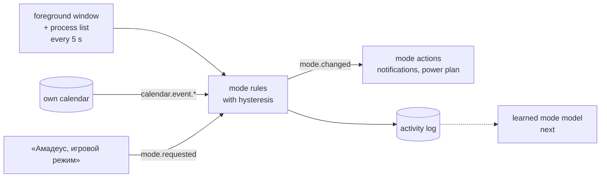

# Mode Autopilot

Phase 2 of [AI For Me](../../README.md): the assistant notices whether I am coding, gaming or in a meeting and sets
the machine up for it — and puts everything back afterwards.

## Modes

| Mode | When | What it does by default |
|---|---|---|
| Gaming | a game is running — anything installed in a Steam, Epic, Riot, Wargaming, GOG, Battle.net or Xbox library, or a known game executable; launchers do not count | notification banners off, High performance power plan |
| Meeting | a meeting in the calendar has started, or Zoom/Teams has been in front for a minute | notification banners off; a spoken reminder 2 minutes before any event |
| Coding | an IDE or a terminal was in front for at least half of the last five minutes | nothing yet — window layouts per project come later |
| Normal | everything else | whatever was there before |

A new mode has to hold for 20 seconds before the switch, so alt-tabbing out of a game or a glance at a browser does
not flip the machine back and forth; a calendar meeting or a voice command switches at once. A mode asked for by
voice holds for two hours or until *«автоматический режим»*. What each mode does is set in `data/modes.json`,
written with the defaults on first start; every change a mode makes is remembered and undone when the machine leaves
it, and again when the assistant exits.

Voice: *«игровой режим»*, *«режим встречи»*, *«switch to work mode»*, *«обычный режим»*, *«что у меня сегодня?»* —
two intents added to the [voice orchestrator](../voice_orchestrator). The mode is read from the slot by its word,
so *«давай игровой режим»* and *"put it in meeting mode"* both land, even when the slot keeps extra words.

## The calendar and the dashboard

Meetings come from the assistant's own [calendar](../calendar), edited in the [dashboard](../dashboard): a week view
where dragging over empty time creates an event and dragging an event moves it. A watcher announces each event on the
bus — *soon*, *started*, *ended* — so the autopilot reacts to the calendar without polling it, and the finance tracker
will read `shift` events the same way. The dashboard's header shows the current mode.

## What comes next: a learned mode model

Every 5-second sample goes into a local activity log (`data/activity.sqlite3`, never committed) with the mode the
rules chose, and every mode asked for by voice is marked as a correction of the rules. Once there are a few weeks of
it, a classifier over the recent activity — which apps, how long in front, time of day — will be trained against the
rules on held-out days, using the corrections as the cases the rules got wrong.
