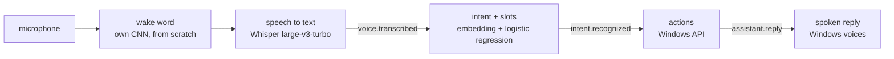

# Voice Orchestrator

Phase 1 of [AI For Me](../../README.md): say «Джарвис» and a command in Russian or English, and the machine does
it — opens or closes an app, finds a file, types dictated text, searches the web, changes the volume, controls
media, takes a screenshot, locks the screen or tells the time.



Every arrow after the microphone is an event on the [bus](../core/bus.py), so each part runs and is tested on
its own; `python -m aiforme say "открой телеграм"` enters the chain after speech recognition.

## What is built from scratch and what is not

| Part | Approach | Why |
|---|---|---|
| Wake word | Own CNN on log-mel features, 60k parameters, trained on my recordings and Windows voices ([aiforme/wakeword](../wakeword)) | A small, well-defined task: a model trained from scratch is enough, and pre-trained wake-word models are licensed for non-commercial use only |
| Speech to text | [faster-whisper](https://github.com/SYSTRAN/faster-whisper), `large-v3-turbo`, on the GPU | Whisper learned from 680,000 hours of audio. An ASR model trained on one GPU and an open corpus of a few hundred hours would misrecognise every third word or worse, and dictation and web search need open vocabulary, not a fixed command list |
| Intent | Text embedding + logistic regression; four embeddings compared below, two of them built only from the training commands | The comparison shows what pretraining buys on 255 examples |
| Slots | Carrier phrases learned from the training data ("open my …"), then fuzzy matching of app names | A baseline to beat with a sequence tagger once there is more data (Phase 3) |

## Intents

`open_app`, `close_app`, `find_file`, `dictate`, `web_search`, `volume_up`, `volume_down`, `mute`, `media_play_pause`,
`media_next`, `screenshot`, `lock_screen`, `tell_time`, `cancel` — and `out_of_scope` for everything else: an explicit
class with its own examples, plus a confidence threshold chosen by cross-validation on the training set.

The data ([data/](data)) is hand-written, Russian and English: 255 training phrases and 152 test phrases written
separately — other wording, Whisper-style capitals and punctuation, slang (*«телегу»*, *«скипни»*), apps the training
data never names, and out-of-scope requests that look like commands (*«открой окно в комнате»*). Both sets were
written by the same person during development, so the numbers are an optimistic estimate.

## Results: intent recognition

Held-out test set, 152 phrases ([evaluate.py](evaluate.py), `eval/results/intent_*.json`):

| Metric | TF-IDF | Char-CNN | MiniLM | E5 |
|---|---|---|---|---|
| Built from | training data only | training data only, trained from scratch | pretrained | pretrained |
| Intent accuracy, all test phrases | 84.9% | 70.4% | 80.3% | **92.8%** |
| In-scope intent accuracy, Russian / English | 84.4% / 87.5% | 67.2% / 68.8% | 68.8% / 90.6% | **95.3% / 92.2%** |
| Out-of-scope recall | 79.2% | 83.3% | 83.3% | **87.5%** |
| Commands wrongly rejected as out-of-scope | 10.9% | 28.9% | 12.5% | **4.7%** |
| Slot exactly right, end to end | 53.6% | 46.4% | 42.9% | **58.9%** |
| Latency per command, CPU | 0.6 ms | 0.9 ms | 18 ms | 20 ms |

<sub>TF-IDF: character 2–5-grams. Char-CNN: character embeddings, filters 2–5 wide, trained on the 255 phrases with
simulated typos; one seed. MiniLM: `paraphrase-multilingual-MiniLM-L12-v2`. E5: `multilingual-e5-small`. The test set
was scored once per model; nothing was tuned on it.</sub>

- **E5 is the default.** It is the only one that is good in both languages; MiniLM, also multilingual, is far weaker
  in Russian (68.8%).
- **From scratch, the simple model wins.** With 255 phrases the char-CNN cannot learn what a pretrained encoder brings
  and loses to TF-IDF, which needs no training at all — the same lesson as in
  [causal-method-advisor](https://github.com/KernerlRace/causal-method-advisor), where a model trained from scratch only
  beat the baseline after pretraining on Wikipedia.
- **Slots are the weak part** for every embedding: carrier phrases the training data never saw (*"could you launch
  chrome"*, *«поищи на диске»*) leave command words in the slot. App matching recovers most of these — it tries every
  span of the phrase — but `find_file` and `web_search` queries stay polluted.

## Results: through speech

The same 152 test phrases, spoken by the Windows voices (Irina for Russian, Zira and Hazel for English), transcribed by
Whisper `large-v3-turbo` on the GPU and classified with E5 ([spoken_eval.py](spoken_eval.py),
`eval/results/spoken_e5.json`):

| Metric | On the written text | Through speech |
|---|---|---|
| Transcript identical after normalisation | — | 89.5% |
| Intent accuracy, all test phrases | 92.8% | **90.1%** |
| In-scope intent accuracy | 93.8% | 90.6% |

Most transcript differences are harmless: brand names in Latin (*«Запусти Photoshop»*), digits for numbers. The costly
ones are misheard words — *«скипни»* became *«Сгибни»* (→ mute), *"Write: okay"* became *"Right, okay"* (→ out of
scope). The slot metric is not shown: it compares strings, so *«телеграм»* against the expected *"telegram"* counts as
wrong although both open the same app. Synthetic voices are clean and accent-free, so this is the cost of Whisper's
errors alone, not of a real room; recordings of real speech are next.

## Running it

```bash
uv sync --all-extras
uv run python -m aiforme run                  # «Джарвис», then a command
uv run python -m aiforme run --push-to-talk   # Enter instead of the wake word
uv run python -m aiforme run --no-voice       # no microphone; then, in another terminal:
uv run python -m aiforme say "сколько времени"
```

Whisper needs an NVIDIA GPU with a recent driver for real-time speed; the CUDA libraries come as pip packages with
the `voice` extra. Without a GPU it falls back to the `small` model on the CPU.
