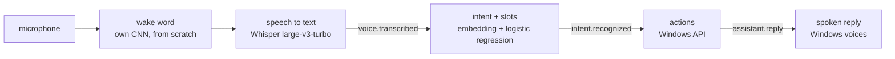

# Voice Orchestrator

Phase 1 of [AI For Me](../../README.md): say «Амадеус» and a command in Russian or English, and the machine does
it — opens or closes an app, finds a file, types dictated text, searches the web, changes the volume, controls
media, takes a screenshot, locks the screen, tells the time, reads today's calendar or switches the machine's mode.



Every arrow after the microphone is an event on the [bus](../core/bus.py), so each part runs and is tested on
its own; `python -m aiforme say "открой телеграм"` enters the chain after speech recognition.

## What is built from scratch and what is not

| Part | Approach | Why |
|---|---|---|
| Wake word | Own CNN on log-mel features, 60k parameters, trained on my recordings, my room and Windows voices, with hard-negative mining ([aiforme/wakeword](../wakeword)) | A small, well-defined task: a model trained from scratch is enough, and pre-trained wake-word models are licensed for non-commercial use only |
| Speech to text | [faster-whisper](https://github.com/SYSTRAN/faster-whisper), `large-v3-turbo`, on the GPU | Whisper learned from 680,000 hours of audio. An ASR model trained on one GPU and an open corpus of a few hundred hours would misrecognise every third word or worse, and dictation and web search need open vocabulary, not a fixed command list |
| Intent | Text embedding + logistic regression; four embeddings compared below, two of them built only from the training commands | The comparison shows what pretraining buys on 255 examples |
| Slots | Carrier phrases learned from the training data ("open my …"), then fuzzy matching of app names | A baseline to beat with a sequence tagger once there is more data (Phase 3) |

## Intents

`open_app`, `close_app`, `find_file`, `dictate`, `web_search`, `volume_up`, `volume_down`, `mute`, `media_play_pause`,
`media_next`, `screenshot`, `lock_screen`, `tell_time`, `cancel`, and from Phase 2 `set_mode` and `agenda` — and
`out_of_scope` for everything else: an explicit
class with its own examples, plus a confidence threshold chosen by cross-validation on the training set.

The data ([data/](data)) is hand-written, Russian and English: 314 training phrases and 170 test phrases written
separately — other wording, Whisper-style capitals and punctuation, slang (*«телегу»*, *«скипни»*), apps the training
data never names, and out-of-scope requests that look like commands (*«открой окно в комнате»*). Both sets were
written by the same person during development, so the numbers are an optimistic estimate.

## Results: intent recognition

Held-out test set, 170 phrases ([evaluate.py](evaluate.py), `eval/results/intent_*.json`):

| Metric | TF-IDF | Char-CNN | MiniLM | E5 |
|---|---|---|---|---|
| Built from | training data only | training data only, trained from scratch | pretrained | pretrained |
| Intent accuracy, all test phrases | 85.9% | 72.4% | 79.4% | **92.4%** |
| In-scope intent accuracy, Russian / English | 83.6% / 89.0% | 68.5% / 71.2% | 68.5% / 87.7% | **93.2% / 93.2%** |
| Out-of-scope recall | 83.3% | **87.5%** | **87.5%** | **87.5%** |
| Commands wrongly rejected as out-of-scope | 12.3% | 28.8% | 17.8% | **4.8%** |
| Slot exactly right, end to end | 53.0% | 40.9% | 36.4% | **54.5%** |
| Latency per command, CPU | 0.6 ms | 1.0 ms | 19 ms | 19 ms |

<sub>TF-IDF: character 2–5-grams. Char-CNN: character embeddings, filters 2–5 wide, trained on the 314 phrases with
simulated typos; one seed. MiniLM: `paraphrase-multilingual-MiniLM-L12-v2`. E5: `multilingual-e5-small`. The test set
was scored once per model; nothing was tuned on it.</sub>

- **E5 is the default.** It is the only one that is good in both languages; MiniLM, also multilingual, is far weaker
  in Russian (68.5%).
- **From scratch, the simple model wins.** With 314 phrases the char-CNN cannot learn what a pretrained encoder brings
  and loses to TF-IDF, which needs no training at all — the same lesson as in
  [causal-method-advisor](https://github.com/KernerlRace/causal-method-advisor), where a model trained from scratch only
  beat the baseline after pretraining on Wikipedia.
- **Slots are the weak part** for every embedding: carrier phrases the training data never saw (*"could you launch
  chrome"*, *«поищи на диске»*) leave command words in the slot. App matching recovers most of these — it tries every
  span of the phrase, and a mode is found by its word (*«давай игровой режим»* → `gaming`, right for all 10 test
  phrases although only 4 slots match exactly) — but `find_file` and `web_search` queries stay polluted.

## Results: wake word

«Амадеус» — the AI in Steins;Gate 0. The detector is a 60k-parameter CNN over 1.5 s of log-mel features, trained from
scratch ([aiforme/wakeword](../wakeword)) on 200 recordings of my voice saying it in ten different ways (quiet, from two
metres, followed by a command, ...), 97 recordings of other phrases and similar-sounding words (*Амадей, Асмодей,
Мадейра*), 70 minutes of my room — videos, games, talk, coughs — and 105 + 526 clips from the Windows voices. Since v4
also on a second speaker: 100 takes, 60 phrases and 10 minutes of her room, recorded on a MacBook with
[tools/mac_recorder](../../tools/mac_recorder). Every clip
is augmented: tempo ±10%, a synthetic room, gain, noise from the room recordings at 3–30 dB SNR. Windows that end inside
the word (*«Ама…»*) are negatives, so it waits for the whole word. Training runs in two rounds: the first model is
streamed over the training room audio and the other phrases, the windows it mistakes for the word become hard
negatives — up to 2000 windows from each, each also once augmented, 4866 in all — and a second model is trained from scratch with them. On an RTX 3060 Ti both rounds take three minutes.

Everything is scored by streaming audio through the exported ONNX model exactly as the assistant runs it
(`eval/results/wakeword*.json`): validation is 15% of the training recordings, held out by file; the test is a separate
session recorded on another day — 50 takes and 10 minutes of a different video playing.

| | v1: 10 min of room audio | v3: 70 min + hard negatives | v4: + a second voice, phrases mined | v5: + whispers |
|---|---|---|---|---|
| Validation: wake words found | 29 of 30 (96.7%) | **30 of 30 (100%)** | **45 of 45 (100%)** | **45 of 45 (100%)** |
| Validation: false accepts in held-out room audio | 6 in 10 min (≈36 an hour) | **0** in 10 min | **0** in 12 min | **0** in 12 min |
| Validation: held-out phrases it fires on | — | 0 of 15 | 0 of 24 | 0 of 24 |
| Test: wake words found, 50 takes | 42 (84%) | 45 (90%) | 44 (88%) | **46 (92%)** |
| — of them whispered, 10 takes | — | 5 | 4 | **6** |
| Test: false accepts, 10 min | 2 (≈12 an hour) | **0** | **0** | **0** |
| Synthetic phrases it fires on, of 79 | — | 2 | **0** | **0** |
| Threshold | 0.977 | 0.97 | 0.98 | 0.94 |

<sub>v4's validation adds the second speaker's held-out files to the same split, so it is not the same set as v3's.
Validation for v1 and v3 uses the same held-out takes and only room audio from the sessions recorded after v1,
which neither model trained on. The v1 test result was looked at — its errors are what motivated recording more room
audio and mining it — but nothing was tuned on the test audio itself.</sub>

What changed, and what each step bought:

- **Synthetic voices alone are useless.** Trained on the Windows voices only, the detector found 26 of 30 validation
  takes but fired 13 times in 2 minutes of room audio. My own recordings made it usable.
- **More room audio and hard negatives** removed the false accepts: v1 fired on a fragment of conversation and on a
  cough. Mining shows in the threshold — after round 1, silencing the validation room audio took 0.999; after
  round 2, 0.97, which gave back the recall.
- **A labelling bug of my own.** The list of similar-sounding negatives contained *«Амадеуса нет»* — the wake word
  itself. Whisper found three such recordings among the negatives (the other two were *"Asmodeus"*, which comes out
  as *"Amadeus"*); they were moved out and the phrases removed from the list. The recorder now logs the prompt behind
  every file.
- **The threshold comes from real audio.** The Windows voices' *«Амадей»* and *"Amadeo"* score higher than anything
  the microphone hears, and holding the threshold above them cost real recall for no fewer false accepts in the room.
  The threshold is now the lowest at which the held-out room audio and my recorded phrases never fire; 2 of 79
  synthetic phrases fire at it, reported rather than obeyed.
- **A second voice broke v3.** On a friend's recordings, which it had never heard, v3 found 85 of 100 wake words, fired
  on 21 of 60 plain commands (*«sound off»*, *«звук погромче»*) and 5 times in 10 minutes of her room: it had learned
  my voice more than the word. Simply adding her recordings made it worse — 78% on my test, the threshold pinned at
  0.999 by her phrases — because a wake-word take gives 15 training windows and a phrase only 3, so her voice itself
  looked like the wake word. Mining the phrases as well as the room fixed it; with one shared cap her phrases took all
  4000 places and the room went unmined (1 false accept on the test), so each source has its own.
- **Whispers, made from speech.** A whisper is speech without the voice: the vocal tract still shapes the sound, but
  noise excites it instead of the vocal folds. `whisperize` keeps each frame's spectral envelope (cepstrally
  smoothed, which drops the pitch harmonics), gives it a random phase and thins out the low end. Measured on my
  recordings it matches real whispers: voicing — the autocorrelation peak at pitch lags — 0.21 against 0.25 for
  real whispers and 0.57 for speech; spectral centroid 2.0 kHz against 2.2 kHz and 1.2 kHz. 15% of training clips
  are whispered, negatives too, so a whisper alone is no cue.
- **The seed matters more than the whispers.** Trained again with other seeds, whispers on and off, all else equal:

  | Seed | Without whispers | With whispers |
  |---|---|---|
  | 0 (v4 → v5) | 88%, whispers 4 of 10 | 92%, 6 of 10 |
  | 1 | 98%, 9 of 10 | 98%, 9 of 10 |
  | 2 | 76%, 0 of 10 | 82%, 3 of 10 |

  The augmentation never hurt and adds about two whispers in ten, with no false accepts in any run. But the seed
  alone moves test recall from 76% to 98%: when a held-out phrase fires in validation the threshold is pinned at
  0.999, and whispers are the first takes to fall under it. v5 is seed 0, the default, as decided before the runs;
  picking seed 1 for its test score would be tuning on the test session. Making training stable across seeds —
  averaging several models, or a validation set large enough to tell them apart — is the next step for it.

Limits. All test misses are whispered — v5 finds 6 of 10 whispers and 40 of 40 of everything else. Zero false
accepts in 22 minutes of held-out audio says the rate is probably below about 8 an hour (the rule of three), not that it
is below one; that needs hours of test audio. On the second voice v4 finds 97 of 100 and fires on none of her phrases,
but those are mostly its training files — her own test session, on another day, is what will measure it.
In live use it woke on «Амадеус» and carried out the commands, Whisper taking 0.6–0.8 s per command once warm.

One finding on the way: the microphone suppresses noise, so its silence is near digital zero. Thresholds measured
from the noise floor then counted breath, key clicks and the beep's echo as speech — the word boundaries in the
training clips were wrong until loudness was measured from the peak instead, and the listener's speech threshold
was too high for a third of quiet speech.

## Results: through speech

The same 170 test phrases, spoken by the Windows voices (Irina for Russian, Zira and Hazel for English), transcribed by
Whisper `large-v3-turbo` on the GPU and classified with E5 ([spoken_eval.py](spoken_eval.py),
`eval/results/spoken_e5.json`):

| Metric | On the written text | Through speech |
|---|---|---|
| Transcript identical after normalisation | — | 90.6% |
| Intent accuracy, all test phrases | 92.4% | **90.0%** |
| In-scope intent accuracy | 93.2% | 90.4% |

Most transcript differences are harmless: brand names in Latin (*«Запусти Photoshop»*), digits for numbers. The costly
ones are misheard words — *«скипни»* became *«Сгибни»* (→ mute), *"Write: okay"* became *"Right, okay"* (→ out of
scope). The slot metric is not shown: it compares strings, so *«телеграм»* against the expected *"telegram"* counts as
wrong although both open the same app. Synthetic voices are clean and accent-free, so this is the cost of Whisper's
errors alone, not of a real room; recordings of real speech are next.

## From real use

The first evenings of using it, read back from the bus log, showed failures no test set had: while a video played,
commands were cut off mid-word (*«Сделай видео чуть-чуть поти…»*) or not heard at all, *«продолжи видео»* came out of
Whisper as *«продолжу видео»* and was not understood, and *«закрой калькулятор»* reported success while the Calculator
stayed open. What changed:

- **The volume goes down while it listens.** After the wake word the master volume drops to 10% and comes back as
  soon as the command is recorded — before it runs, so *«громче»* acts on the real level.
- **The end of a command is heard by a speech model, not by loudness.** Loudness was measured against the room, and
  the room was a loud video, so a voice next to it counted as silence. Silero VAD (shipped with faster-whisper) now
  runs as a stream on 32 ms chunks and decides what is speech.
- **Play and pause act on what is playing.** The media session API — the one behind the volume flyout — says
  whether a video plays and in which app; *«пауза»* pauses it and says so when nothing plays, *«продолжи»* resumes,
  instead of a play/pause key that toggles the wrong way half the time.
- **Apps close through their windows, and failures are reported.** Store apps such as the Calculator draw their
  window from another process, so ending theirs did nothing; the assistant now closes the window as its close
  button does, checks that it went, and says *«не закрылось — возможно, просит сохранить изменения»* if it did not.
- **Real phrasings went into training**, Whisper's mistakes included (*«продолжу видео»*): 25 phrases. On the
  written test set they change nothing measurable — 92.4% before and after — because it has no phrases like them.
  That is the case for a test set made of real commands, which is where Phase 3 starts.

## Running it

```bash
uv sync --all-extras
uv run python -m aiforme run                  # «Амадеус», then a command
uv run python -m aiforme run --push-to-talk   # Enter instead of the wake word
uv run python -m aiforme run --no-duck        # keep the volume while listening
uv run python -m aiforme run --no-voice       # no microphone; then, in another terminal:
uv run python -m aiforme say "сколько времени"
```

Whisper needs an NVIDIA GPU with a recent driver for real-time speed; the CUDA libraries come as pip packages with
the `voice` extra. Without a GPU it falls back to the `small` model on the CPU.
