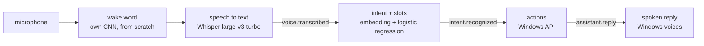

# Voice Orchestrator

Phase 1 of [AI For Me](../../README.md): say «Амадеус» and a command in Russian or English, and the machine does
it — opens or closes an app, finds a file, types dictated text, searches the web, changes the volume, controls
media, takes a screenshot, locks the screen, tells the time, reads today's calendar or switches the machine's mode.



Every arrow after the microphone is an event on the [bus](../core/bus.py), so each part runs and is tested on
its own; `python -m aiforme say "открой телеграм"` enters the chain after speech recognition.

## What is built from scratch and what is not

| Part | Approach | Why |
|---|---|---|
| Wake word | Own CNN on log-mel features, 60k parameters, trained on my recordings, my room and Windows voices, with hard-negative mining ([aiforme/wakeword](../wakeword)) | A small, well-defined task: a model trained from scratch is enough, and pre-trained wake-word models are licensed for non-commercial use only |
| Speech to text | [faster-whisper](https://github.com/SYSTRAN/faster-whisper), `large-v3-turbo`, on the GPU | Whisper learned from 680,000 hours of audio. An ASR model trained on one GPU and an open corpus of a few hundred hours would misrecognise every third word or worse, and dictation and web search need open vocabulary, not a fixed command list |
| Intent | Text embedding + logistic regression; four embeddings compared below, two of them built only from the training commands | The comparison shows what pretraining buys on 255 examples |
| Slots | Carrier phrases learned from the training data ("open my …"), then fuzzy matching of app names | A baseline to beat with a sequence tagger once there is more data (Phase 3) |

## Intents

`open_app`, `close_app`, `find_file`, `dictate`, `web_search`, `volume_up`, `volume_down`, `mute`, `media_play_pause`,
`media_next`, `screenshot`, `lock_screen`, `tell_time`, `cancel`, and from Phase 2 `set_mode` and `agenda` — and
`out_of_scope` for everything else: an explicit
class with its own examples, plus a confidence threshold chosen by cross-validation on the training set.

The data ([data/](data)) is hand-written, Russian and English: 289 training phrases and 170 test phrases written
separately — other wording, Whisper-style capitals and punctuation, slang (*«телегу»*, *«скипни»*), apps the training
data never names, and out-of-scope requests that look like commands (*«открой окно в комнате»*). Both sets were
written by the same person during development, so the numbers are an optimistic estimate.

## Results: intent recognition

Held-out test set, 170 phrases ([evaluate.py](evaluate.py), `eval/results/intent_*.json`):

| Metric | TF-IDF | Char-CNN | MiniLM | E5 |
|---|---|---|---|---|
| Built from | training data only | training data only, trained from scratch | pretrained | pretrained |
| Intent accuracy, all test phrases | 84.1% | 71.2% | 80.6% | **92.4%** |
| In-scope intent accuracy, Russian / English | 82.2% / 86.3% | 64.4% / 74.0% | 72.6% / 90.4% | **94.5% / 93.2%** |
| Out-of-scope recall | **83.3%** | **83.3%** | 75.0% | **83.3%** |
| Commands wrongly rejected as out-of-scope | 13.7% | 28.1% | 11.0% | **4.8%** |
| Slot exactly right, end to end | 51.5% | 42.4% | 40.9% | **56.1%** |
| Latency per command, CPU | 0.6 ms | 1.2 ms | 20 ms | 19 ms |

<sub>TF-IDF: character 2–5-grams. Char-CNN: character embeddings, filters 2–5 wide, trained on the 289 phrases with
simulated typos; one seed. MiniLM: `paraphrase-multilingual-MiniLM-L12-v2`. E5: `multilingual-e5-small`. The test set
was scored once per model; nothing was tuned on it.</sub>

- **E5 is the default.** It is the only one that is good in both languages; MiniLM, also multilingual, is far weaker
  in Russian (72.6%).
- **From scratch, the simple model wins.** With 289 phrases the char-CNN cannot learn what a pretrained encoder brings
  and loses to TF-IDF, which needs no training at all — the same lesson as in
  [causal-method-advisor](https://github.com/KernerlRace/causal-method-advisor), where a model trained from scratch only
  beat the baseline after pretraining on Wikipedia.
- **Slots are the weak part** for every embedding: carrier phrases the training data never saw (*"could you launch
  chrome"*, *«поищи на диске»*) leave command words in the slot. App matching recovers most of these — it tries every
  span of the phrase, and a mode is found by its word (*«давай игровой режим»* → `gaming`, right for all 10 test
  phrases although only 4 slots match exactly) — but `find_file` and `web_search` queries stay polluted.

## Results: wake word

«Амадеус» — the AI in Steins;Gate 0. The detector is a 60k-parameter CNN over 1.5 s of log-mel features, trained from
scratch ([aiforme/wakeword](../wakeword)) on 200 recordings of my voice saying it in ten different ways (quiet, from two
metres, followed by a command, ...), 97 recordings of other phrases and similar-sounding words (*Амадей, Асмодей,
Мадейра*), 70 minutes of my room — videos, games, talk, coughs — and 105 + 526 clips from the Windows voices. Every clip
is augmented: tempo ±10%, a synthetic room, gain, noise from the room recordings at 3–30 dB SNR. Windows that end inside
the word (*«Ама…»*) are negatives, so it waits for the whole word. Training runs in two rounds: the first model is
streamed over the 60 training minutes of room audio, the ~900 windows it mistakes for the word become hard negatives,
and a second model is trained from scratch with them. On an RTX 3060 Ti both rounds take three minutes.

Everything is scored by streaming audio through the exported ONNX model exactly as the assistant runs it
(`eval/results/wakeword*.json`): validation is 15% of the training recordings, held out by file; the test is a separate
session recorded on another day — 50 takes and 10 minutes of a different video playing.

| | v1: 10 min of room audio | v3: 70 min + hard negatives |
|---|---|---|
| Validation: wake words found, 30 takes | 29 (96.7%) | **30 (100%)** |
| Validation: false accepts, 10 min of held-out room audio | 6 (≈36 an hour) | **0** |
| Test: wake words found, 50 takes | 42 (84%) | **45 (90%)** |
| Test: false accepts, 10 min | 2 (≈12 an hour) | **0** |
| Threshold | 0.977 | 0.97 |

<sub>Validation for both models uses the same held-out takes and only room audio from the sessions recorded after v1,
which neither model trained on. The v1 test result was looked at — its errors are what motivated recording more room
audio and mining it — but nothing was tuned on the test audio itself.</sub>

What changed, and what each step bought:

- **Synthetic voices alone are useless.** Trained on the Windows voices only, the detector found 26 of 30 validation
  takes but fired 13 times in 2 minutes of room audio. My own recordings made it usable.
- **More room audio and hard negatives** removed the false accepts: v1 fired on a fragment of conversation and on a
  cough. Mining shows in the threshold — after round 1, silencing the validation room audio took 0.999; after
  round 2, 0.97, which gave back the recall.
- **A labelling bug of my own.** The list of similar-sounding negatives contained *«Амадеуса нет»* — the wake word
  itself. Whisper found three such recordings among the negatives (the other two were *"Asmodeus"*, which comes out
  as *"Amadeus"*); they were moved out and the phrases removed from the list. The recorder now logs the prompt behind
  every file.
- **The threshold comes from real audio.** The Windows voices' *«Амадей»* and *"Amadeo"* score higher than anything
  the microphone hears, and holding the threshold above them cost real recall for no fewer false accepts in the room.
  The threshold is now the lowest at which the held-out room audio and my recorded phrases never fire; 2 of 79
  synthetic phrases fire at it, reported rather than obeyed.

Limits. All five test misses are whispered — 5 of 10 whispers found, 40 of 40 of everything else. Zero false accepts
in 20 minutes of held-out audio says the rate is probably below about 9 an hour (the rule of three), not that it is
below one; that needs hours of test audio. And it has only heard one voice — a second speaker's test session is next.
In live use it woke on «Амадеус» and carried out the commands, Whisper taking 0.6–0.8 s per command once warm.

One finding on the way: the microphone suppresses noise, so its silence is near digital zero. Thresholds measured
from the noise floor then counted breath, key clicks and the beep's echo as speech — the word boundaries in the
training clips were wrong until loudness was measured from the peak instead, and the listener's speech threshold
was too high for a third of quiet speech.

## Results: through speech

The same 170 test phrases, spoken by the Windows voices (Irina for Russian, Zira and Hazel for English), transcribed by
Whisper `large-v3-turbo` on the GPU and classified with E5 ([spoken_eval.py](spoken_eval.py),
`eval/results/spoken_e5.json`):

| Metric | On the written text | Through speech |
|---|---|---|
| Transcript identical after normalisation | — | 90.6% |
| Intent accuracy, all test phrases | 92.4% | **90.6%** |
| In-scope intent accuracy | 93.8% | 91.8% |

Most transcript differences are harmless: brand names in Latin (*«Запусти Photoshop»*), digits for numbers. The costly
ones are misheard words — *«скипни»* became *«Сгибни»* (→ mute), *"Write: okay"* became *"Right, okay"* (→ out of
scope). The slot metric is not shown: it compares strings, so *«телеграм»* against the expected *"telegram"* counts as
wrong although both open the same app. Synthetic voices are clean and accent-free, so this is the cost of Whisper's
errors alone, not of a real room; recordings of real speech are next.

## Running it

```bash
uv sync --all-extras
uv run python -m aiforme run                  # «Амадеус», then a command
uv run python -m aiforme run --push-to-talk   # Enter instead of the wake word
uv run python -m aiforme run --no-voice       # no microphone; then, in another terminal:
uv run python -m aiforme say "сколько времени"
```

Whisper needs an NVIDIA GPU with a recent driver for real-time speed; the CUDA libraries come as pip packages with
the `voice` extra. Without a GPU it falls back to the `small` model on the CPU.
